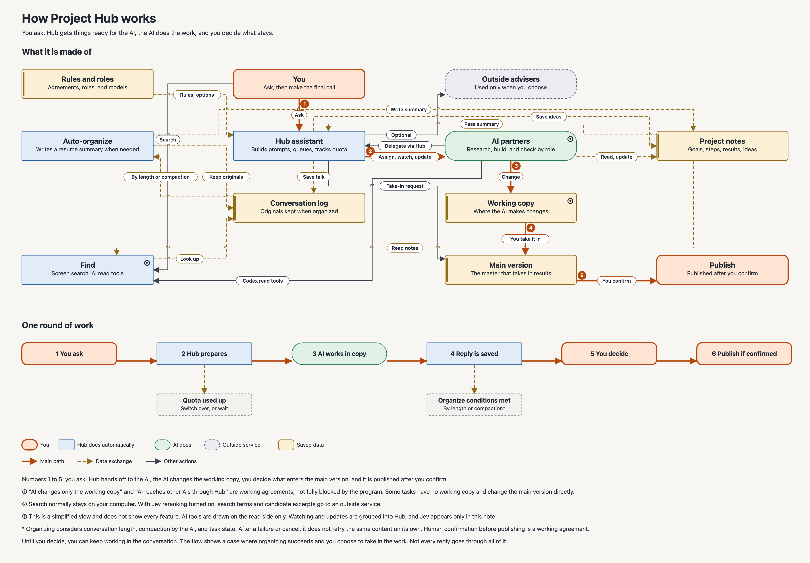
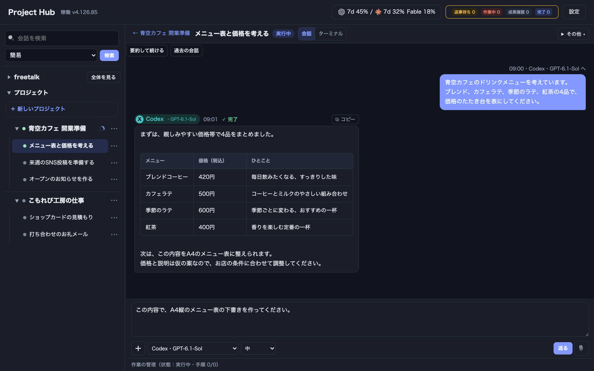
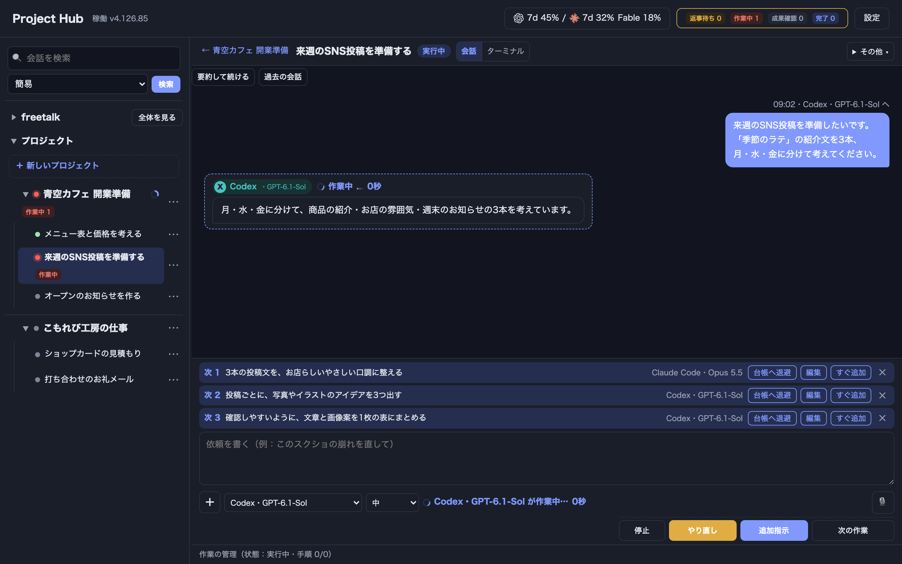

# Project Hub

[日本語](README.md) | English | [繁體中文](README.zh-TW.md)

Introduction page: <https://k-onedot.com/ai/project-hub/en/>

**Project Hub has official releases for both Mac and Windows.** The current public version for both is [4.126.95 (latest)](https://github.com/kieiken/project-hub/releases/latest). Feedback, bug reports, and pull requests are welcome. See [CONTRIBUTING.md](CONTRIBUTING.md) (Japanese) for how to send them.

Project Hub lists your projects and tasks and runs Claude Code / Codex inside its own screen. It is for one person on a Mac or on Windows 11 x64. It listens only on `127.0.0.1` and has no user authentication, so it cannot be used as a web service or a shared server.

Before you use it, read "使う前に知っておくこと" (what to know before use) in [hub/README.md](hub/README.md) (Japanese).

The app's display is in Japanese. English and Traditional Chinese language packs are available from the release page, and some screens stay in Japanese. Most detailed documents in this repository are in Japanese.

Source version in this repository: 4.126.95 (released versions are listed above).

## How it works

This diagram shows how a request goes through Hub to the AI, and how a person decides what is taken in and published. It is simplified from the development source as of November 2026. It does not show every feature and may differ in part from the released version.

[](docs/project-hub/structure-map-v2-reader-en.png)

Select the image to open it at full size.

## Screens

These are screens from development version v4.126.85. All content is fictional and for illustration (no real user data). Some of the display may differ from the released version.

### Work conversation

Checking the task list of a fictional cafe and a menu pricing draft made by AI.

[](docs/screenshots/conversation-v4.126.85-usage.png)

### Lining up the next instructions

Preparing social posts for a fictional cafe, with the next instructions lined up: adjust the text, draft images, make a table.

[](docs/screenshots/queued-instructions-v4.126.85-usage.png)

You can also search every project and free talk conversation by keyword, then open the message you found and the conversation around it.

## Requirements

- macOS (Apple Silicon, macOS 13 or later) or Windows 11 x64. For Windows, see "Windows" below
- Node.js 22 or later, Git
- The AI CLIs you will use (Claude Code / Codex / Agy CLI for Gemini), installed and logged in
- Apple's developer tools, to build the terminal component (node-pty) and the app (Project Hub.app)

## Getting started (Mac)

In the top folder you downloaded (where this README is), run:

```
bash hub/setup.sh
```

- It creates `_hub/`, `Product/`, and `Work/` in `~/Documents/AI-Workspace/`. Change the location with `HUB_ROOT`
- It is safe to run repeatedly. It leaves an existing `roles.yaml` and ledgers (folders containing `PROJECT.md`) alone
- It installs node-pty with npm and creates Project Hub.app on the desktop

The AI account settings show Gemini (default account only) and ChatGPT. Role assignment can use logged-in Claude Code, Codex, and Gemini (not ChatGPT).

For usage and updates, see [hub/README.md](hub/README.md) (Japanese).

## Windows

For Windows 11 x64 there is a browser route and an unsigned dedicated window using WebView2. For setup and launch, read the [Windows window guide](hub/app/windows/README.md) (Japanese). In a prepared folder, `hub/start-window.cmd` opens the dedicated window and `hub/start.cmd` opens the browser version. Use normal permissions and do not run as administrator. The Mac `setup.sh` is not used.

Official Windows 11 x64 releases are on the [releases page](https://github.com/kieiken/project-hub/releases). There is no publisher signature, so a Windows warning may appear the first time. In-app updates replace only the processing inside the app. Some features, such as Mac-only isolated execution, are not available on Windows.

Data goes in a fixed local NTFS location. Because this uses file write commits and same-drive replacement, administrator rights are not needed. However, reliability right after a rename or delete during a power loss may be weaker than the earlier method, which committed writes for the whole drive.

Blurry text in the dedicated window has been reported, and an improvement is being checked.

## Notes

- **AI permission prompts**: By default, Claude Code starts without permission prompts, and Codex starts without permission prompts or a sandbox. AI can rewrite files and run commands with your permissions. To change this, set `permissions` in `_hub/roles.yaml`
- **Fees**: AI fees, plans, and billing follow each CLI's settings. Project Hub does not guarantee that no fees apply
- For automatic Git saves, settings files copied to working copies, records left locally, and similar notes, see [hub/README.md](hub/README.md) (Japanese)

## Tests

```
HUB_SKIP_NPM=1 npm --prefix hub test
```

Without node-pty, checks that actually run the terminal screen are skipped.

## Bundled starter ledgers (seed)

`hub/seed/` holds ledgers for a fictional "sample app", "sample site", "sample document", and "Project Hub". They are not records of real projects or work. `setup.sh` copies them to `Product/<name>/`.

## About this public copy

This folder is the Project Hub part only, cut out without Git history. In a Git working copy, `node scripts/export-public.js` rebuilds `public-release/ProjectHub` from committed files. Use `--ref <commit>` to pin the product code version and `--public-ref <commit>` to take public documents from another commit.

- Real work records (`.ai/` conversations, handoffs, and so on) are not included. Only the `.ai/` files needed by templates and fictional ledgers are included
- The public [CHANGELOG](hub/CHANGELOG.md) starts at 4.20.0 (earlier records are left out because they contain past materials)

## References

These informed the design. Neither is bundled or depended on.

- teddashh/bat-agent-connector (MIT): watching for input waits, pre-merge checks, operation records
- arumwu/goose-acp-handoff: handoff materials when switching AI

## License

Project Hub is under the MIT License (Copyright (c) 2026 kieiken). The full text is in [LICENSE](LICENSE).

This software began in the repository of the Discord Bot template "discordpy-startup" (MIT, Copyright (c) 2019-2020 Discord Bot Portal JP). The template's Bot, Python, and Heroku settings are not in this public copy, but its copyright notice and license text remain as a record of origin.

For third-party software such as the bundled xterm.js and node-pty installed by npm, see [THIRD_PARTY_NOTICES.md](THIRD_PARTY_NOTICES.md) (Japanese).

## Feedback, bugs, and pull requests

Feedback and bug reports are welcome for official releases too.

- **Feedback and requests**: use the feedback option under [Issues](https://github.com/kieiken/project-hub/issues/new/choose). A single line about where you used it, what worked, or what was confusing is fine.
- **Bugs**: use the bug report option under Issues. Include the version (top right of the screen, or hub/package.json), your macOS and Node.js versions, the steps, and what happened.
- **Pull requests**: welcome. For large changes, please discuss in an Issue first.
- When pasting conversations, ledgers, or screenshots, remove names, paths, passphrases, tokens, and other personal or secret details first.

## Main features

For the full feature notes, see "主な機能" in [README.md](README.md) (Japanese). In short, Project Hub covers:

- An Idea Ledger for text and images in each project. Only items saved as planned work become production targets
- Moving queued instructions to the ledger without starting any work
- Discussion among 2 to 4 AI and model pairs, run in order and read-only
- Connecting an existing GitHub repository (registers the destination and display only; content and history are not synced)
- Selective integration of child task results
- Optional automatic sending to Chat / Pro through an external WebChatMCP (off by default; separate setup and real-device checks needed)
- AI account switching and usage display, free talk, protected deletion and restore, and Markdown table display in conversations
- Automatic Project Hub updates are off by default and need Git source, target app, and disk check settings. See [hub/README.md](hub/README.md#project-hub-の自動更新) (Japanese)
- The Mac App CI builds a self-signed Traditional Chinese app without notarization. Running it still needs Node.js 22 or later and the AI CLIs you use
